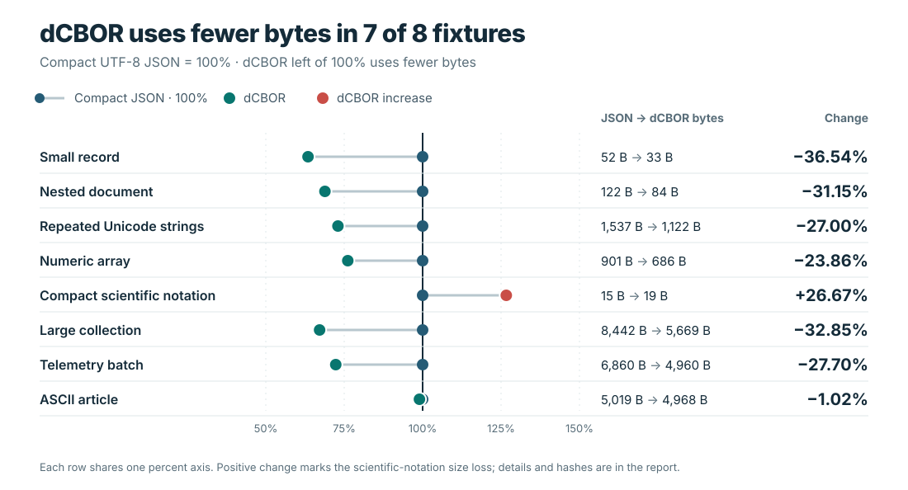

# dcbor

`dcbor` provides Python bindings for [Blockchain Commons' Rust `dcbor`
crate](https://github.com/BlockchainCommons/bc-dcbor-rust). It encodes and
decodes deterministic CBOR (dCBOR), applying shortest-form integer and float
encodings, NFC text normalization, bytewise-lexicographic map-key ordering, and validation
of canonical input. The codec implements RFC 8949 deterministic encoding with
the dCBOR application profile.

Core encoding/decoding runs in the Rust crate via [PyO3](https://pyo3.rs/).
The binding preflight checks complete input structure, nesting depth, map-count
overflow, and aggregate encoded map-key storage. The pinned, locally patched
decoder validates numeric canonicality before converting float payloads.
The published `dcbor` 0.25.2 codec is included with a narrow numeric-reduction
patch; its source, license, provenance, and changes are in
[`crates/dcbor`](crates/dcbor/PATCHES.md).

## Install (from source)

```sh
pip install maturin
maturin develop --release   # or: maturin build --release && pip install target/wheels/*.whl
```

## Usage

```python
import dcbor

data = dcbor.dumps({"b": 2, "a": [1, 2, 3], "c": None})
assert dcbor.loads(data) == {"a": [1, 2, 3], "b": 2, "c": None}

print(dcbor.diagnostic(data))
# {"a": [1, 2, 3], "b": 2, "c": null}
```

## Evidence at a glance

This project targets RFC 8949 deterministic encoding with the dCBOR profile in
[draft-mcnally-deterministic-cbor-18 §2.5](https://www.ietf.org/archive/id/draft-mcnally-deterministic-cbor-18.html#section-2.5).
The tests provide evidence for that documented profile; they are not an
external certification. One explicit compatibility exception for large
negative integer input is described in [Numeric compatibility target](#numeric-compatibility-target).
A source-based survey of dCBOR implementations, generic CBOR libraries, and
related formats is in the [competitive landscape](docs/competitive-landscape.md).

The independent [wire-vector tests](tests/test_spec_conformance.py) cover
numeric forms, malformed and noncanonical inputs, Unicode NFC, map ordering,
and duplicate keys. The [numeric oracle](tests/test_numeric_oracle.py),
[wire-safety tests](tests/test_wire_safety.py),
[datetime/depth tests](tests/test_datetime_depth.py), and
[key-identity tests](tests/test_key_identity.py) cover additional numeric,
resource-limit, date, and key-identity behavior. CI runs CPython 3.9–3.14; the
full suite, including exhaustive cases, runs on CPython 3.14, while other
versions omit only tests marked `exhaustive`. Pull requests build reduced
Linux wheels for CPython 3.12–3.14. Manual and release builds validate 42
wheels: six Python versions across seven platform/architecture combinations,
as defined by the [build workflow](.github/workflows/ci.yml) and
[distribution checker](scripts/ci.py).

The chart compares compact UTF-8 JSON bytes with dCBOR wire bytes for the same
six JSON-compatible fixtures. It reports serialized payload size, not memory
use. In the recorded CPython 3.14.7 run, dCBOR used 33 vs 52 bytes for a small
record, 84 vs 122 for a nested document, 1,122 vs 1,537 for repeated Unicode
strings, 686 vs 901 for a numeric array, and 5,669 vs 8,442 for a 128-record
collection. For compact scientific-notation floats, JSON used 15 bytes and
dCBOR used 19 (+26.67%). The other five fixtures favored dCBOR by 23.86% to
36.54%. This mix includes a result unfavorable to dCBOR and is still too narrow
to establish a general size advantage.



The [fixture definitions, raw measurements, environment, hashes, and graph
generator](benchmarks/encoded_size/README.md) let readers reproduce this chart.
The raw report records source-worktree status and generator, extension, and
chart hashes.
The separate [competitor wire-size report](benchmarks/wire_size/README.md)
compares dCBOR with `cbor2` and `cborx` default and canonical modes; its current
[machine-readable report](benchmarks/wire_size/results.json) and
[stable graph](.github/assets/graphs/wire-size.svg) contain completed
measurements for six JSON-compatible fixtures.
The [latency methodology](benchmarks/latency/README.md) uses the same codecs
and fixtures for encode, decode, and round-trip speed. Its current
[machine-readable report](benchmarks/latency/results.json) records nine fresh
process samples per operation and the
[stable graph](.github/assets/graphs/latency.svg) includes slow results as
well as wins. These results describe one host; they do not support a general
speed ranking. PostgreSQL JSONB is a database storage and query alternative;
the [competitive landscape](docs/competitive-landscape.md)
explains why it needs a separate database benchmark. The
[benchmark index](benchmarks/README.md) links to reports and reproduction
instructions.

### Supported types

| Python                 | dCBOR                          |
|------------------------|---------------------------------|
| `None`                 | simple value `null`             |
| `bool`                 | simple value `true`/`false`     |
| `int`                  | major type 0/1 (unsigned/negative, must fit `[-2**64, 2**64-1]`) |
| `float`                | preferred-width float; integral values in `[-2**63, 2**64)` reduce to integers |
| `str`                  | major type 3 text string (NFC-normalized; lone surrogates rejected) |
| `bytes` / `bytearray`  | major type 2 byte string        |
| `list` / `tuple`       | major type 4 array              |
| `dict` / `dcbor.CBORMap` | major type 5 map (keys sorted into canonical order automatically) |
| `datetime.datetime`    | tag 1 (epoch date/time)         |
| `dcbor.CBORTag`        | arbitrary tag (major type 6)    |

`loads()` maps numeric tag 1 values to aware UTC `datetime.datetime` values.
Nonfinite timestamps and dates outside Python's supported range raise
`CBORError`. Other tags, including nonnumeric tag 1 values, decode to `CBORTag`.
`datetime.datetime` values passed to `dumps()` must be timezone-aware —
naive datetimes are rejected with `CBORError` rather than silently encoded
using the host machine's local timezone, which would make the encoding
depend on where it runs (unacceptable for a *deterministic* format).

Maps normally decode to `dict`. When keys are unhashable or distinct CBOR
keys compare equal in Python (such as `1` and `True`), they decode to
`CBORMap`, a read-only snapshot with lookups based on canonical key encodings:

```python
mapping = dcbor.CBORMap([(1, "integer"), (True, "boolean")])
assert mapping[1] == "integer"
assert mapping[True] == "boolean"
assert dcbor.dumps(dcbor.loads(dcbor.dumps(mapping))) == dcbor.dumps(mapping)
```

`CBORMap` supports indexing, membership, iteration, `len()`, `get()`,
`keys()`, `values()`, and `items()`. Returned containers are fresh decoded
values; changing them does not modify the snapshot. Its constructor accepts
key/value pairs and rejects duplicate canonical keys. Python `dict` encoding
keeps its established last-entry-wins behavior when different string keys
normalize to the same NFC encoding; this compatibility behavior is distinct
from `CBORMap`'s duplicate-canonical-key rejection. Converting a `CBORMap` to a
Python `dict` can lose distinctions such as `1` versus `True`.

Map-key conversion preserves canonical encoding throughout composite keys.
Numeric date keys become `datetime` only when that conversion round-trips
exactly; otherwise they retain their original `CBORTag` representation.
Thus keys returned by iteration, `keys()`, and `items()` remain usable for
membership checks and lookup, including sub-microsecond date keys.

`CBORTag` remains mutable and is unhashable. Tagged map keys use `CBORMap`.
Strings are read from their actual Unicode contents, without calling a
subclass's `__str__`. Lone surrogates raise `CBORError` because they cannot be
represented as valid CBOR UTF-8 text; they are never silently replaced.

### Numeric compatibility target

Floating-point reduction follows
[draft-mcnally-deterministic-cbor-18 §2.5](https://www.ietf.org/archive/id/draft-mcnally-deterministic-cbor-18.html#section-2.5).
For example, `-float(2**64)` stays a float (`fadf800000`), while an explicit
Python integer `-(2**64)` keeps its integer encoding (`3bffffffffffffffff`).
Float values below `-2**63` are preserved through decoding, diagnostics, and
map-key serialization as well as encoding.

For compatibility, explicit integers retain the documented full CBOR range
`[-2**64, 2**64-1]`. The draft's Appendix A rejects some large negative integer
encodings without an equally explicit prohibition in its normative integer
rules. This binding preserves its existing integer API while that ambiguity
remains; it does not claim strict agreement with those Appendix A rejection
vectors. `CBORMap` can preserve a large negative integer and the numerically
equal, separately encoded float as distinct keys.

### Errors

Malformed or non-canonical dCBOR raises `dcbor.CBORError` (a subclass of
`Exception`) on `loads()`/`diagnostic()`/`validate()`. Values that can't be
represented in dCBOR (unsupported Python types, out-of-range integers) raise
`dcbor.CBORError` from `dumps()`.

### Known limitations

- **Map representation.** Arrays, maps, and mutable tags can be keys in
  `CBORMap`, which preserves their encoded identity without Python hashing.
- **NFC string collisions.** dCBOR text strings are normalized to Unicode
  NFC before encoding. Two distinct Python strings that normalize to the
  same NFC form (e.g. `"é"` composed vs. `"e"` + combining acute) encode
  identically. For `dict` input, the later item deliberately wins for
  compatibility; `CBORMap` instead rejects duplicate canonical pairs.
- **Nesting depth is capped at 512 levels** (arrays/maps/tags, on both
  `dumps()` and `loads()`) to prevent stack-exhaustion crashes on
  adversarial input; deeper structures raise `CBORError` rather than
  crashing the process.
- **Encoded map-key storage is capped at 16 MiB in aggregate.** Keys nested
  inside other keys count at every level, matching the upstream decoder's
  cached copies. Inputs exceeding this budget raise `CBORError` before
  recursive decoding. Encoding reserves the same budget during conversion,
  before caching keys or descending into their values, across nested maps
  and repeated shared objects. Text is normalized before accounting so the
  budget includes its canonical UTF-8 bytes and encoded length headers.
  This bounds key-cache amplification, not
  total input size or all process memory.
- **Datetime precision.** Fractional epoch timestamps use floating-point
  seconds. Microseconds far from the Unix epoch may lose precision, and
  decoded timestamps are limited to Python's datetime resolution and range.
- **Interpreter coverage.** CI targets regular CPython 3.9–3.14. Free-threaded
  CPython and alternative interpreters are not currently in the build matrix.
  Local verification has used CPython 3.14; cross-platform results are reported
  by GitHub Actions.

## Development

```sh
python3 -m venv .venv && source .venv/bin/activate
pip install maturin pytest
maturin develop
pytest
```

For coding-agent build, test, and release guidance, see the
[agent workflow](docs/agent-workflow.md).

The full numeric-oracle and binary16 exhaustive cases run on CPython 3.14/Linux.
Other interpreter and wheel jobs run the rest of the suite, including the
independent conformance and safety tests. The source distribution runs the full
suite before wheel builds.

The upstream codec has a named maintainer and a repeatable checksum, patch, and
test verification process in [`crates/dcbor/PATCHES.md`](crates/dcbor/PATCHES.md).
Current performance follow-ups are recorded in
[`docs/allocation-plan.md`](docs/allocation-plan.md).

## CI and releases

The [build workflow](.github/workflows/ci.yml) runs on pull requests, pushes to
`master`/`main`, manual dispatches, and reusable workflow calls. A separate
[release workflow](.github/workflows/release.yml) starts on version-tag pushes
and uses that build workflow for a full matrix if a matching validated bundle
is unavailable. The build workflow:

1. Check that Python and Cargo package versions agree with the public
   `dcbor.__version__`.
2. Run the vendored Rust codec tests once with `--locked`, using the committed
   `crates/dcbor/Cargo.lock` (separate from the binding's root lockfile).
3. Build the extension on CPython 3.9–3.14. Run the full suite on CPython
   3.14/Linux; other Python versions exclude only tests marked `exhaustive`.
4. Create an sdist and verify it installs and passes the full test suite.
5. Build release wheels **from that sdist**, then install and test every wheel
   in an isolated environment using [cibuildwheel](https://cibuildwheel.pypa.io/).
   Wheel tests exclude only tests marked `exhaustive`; all remaining conformance
   and safety tests run on every wheel.
   Routine branch pushes and pull requests build reduced Linux wheels for
   CPython 3.12–3.14 using pinned x86_64 build images. Manual dispatches and
   release builds use the full platform matrix; reusable callers request full
   coverage by default, while pull-request callers remain reduced.
6. For full-matrix builds, check distribution metadata, require all 42 wheels,
   generate `SHA256SUMS` and build provenance, and upload a versioned
   `release-vX.Y.Z` artifact. The tag-triggered release workflow validates and
   publishes the release assets.

| Platform | Architecture | Build environment | Python versions |
| --- | --- | --- | --- |
| Linux glibc 2.28+ | x86_64, aarch64 | manylinux_2_28 Docker images | 3.9–3.14 |
| Linux musl 1.2+ | x86_64, aarch64 | musllinux_1_2 Docker images | 3.9–3.14 |
| macOS 11+ | Intel, Apple Silicon | Native GitHub macOS runner images | 3.9–3.14 |
| Windows | x64 | Windows 2022 runner image with MSVC | 3.9–3.14 |

ARM builds run on native ARM runners. Linux packaging images are selected by
cibuildwheel; macOS and Windows use native runner images because their toolchains
require those operating systems. Rust is pinned to 1.90.0 in the workflow and Linux
container setup. Update both together. Dependabot checks action updates weekly.
Compiler jobs are limited to two; wheel jobs fan out by platform and interpreter.
The build workflow starts with a small Ubuntu change-detection job. If a push or
pull request changes only Markdown files, the test and build jobs are skipped;
skipped job checks report success. Manual dispatches run the full matrix. The
release workflow requires stable `vX.Y.Z` tags and publishes a GitHub Release
after validating its complete bundle; see the
[release guide](docs/releasing.md) for its assets and retry behavior.

Separate [maintenance checks](maintenance/README.md) cover build/release tools
in a path-filtered workflow. They do not run in the build pipeline or ship in
source distributions. Branch push runs stay independent so a docs-only push
cannot cancel earlier code validation; superseded PR runs may cancel because
their diffs are cumulative.

The patched `crates/dcbor` sources and license must be committed with the project.
Do not replace them with the unpatched registry crate. The sdist includes this
dependency and the Python tests so packaging failures are caught before release.

For the initial `v0.1.0` release and later patch releases, see the
[release guide](docs/releasing.md). It covers version updates, tag creation,
bundle reuse or full-build fallback, release assets, retries, and GitHub-only
publication.

For a lightweight local check on an 8 GB machine:

```sh
CARGO_BUILD_JOBS=2 maturin develop --release --locked
python -m pytest -q
maturin sdist --out dist
```

Leave the full platform matrix to Actions. The versioned `release-vX.Y.Z`
artifact is retained for 30 days, with individual build artifacts retained for
14 days.

## License

BSD-2-Clause-Patent, matching the upstream `dcbor` Rust crate.
