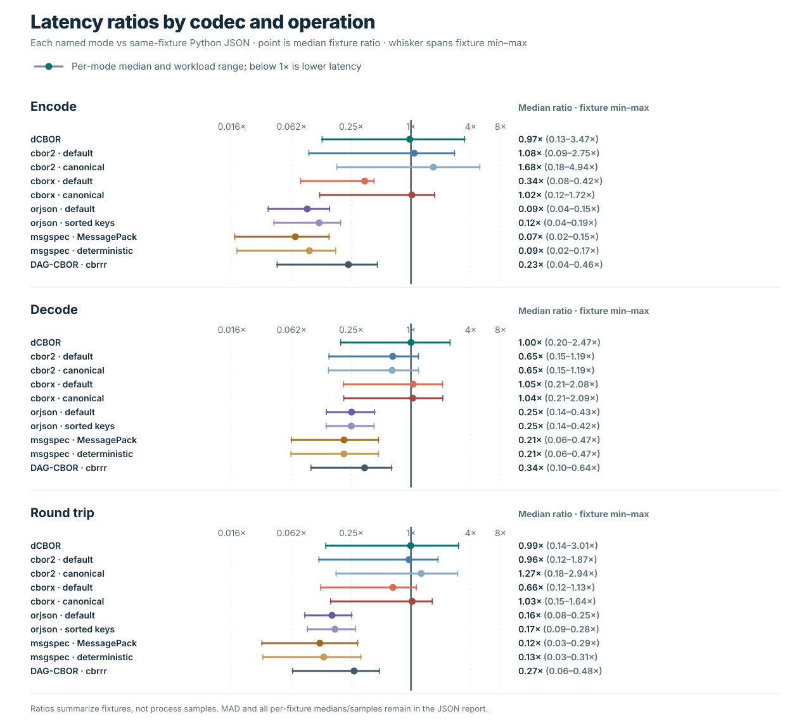

# Latency comparison

This harness compares encode, decode, and round-trip latency for the same eight
JSON-compatible fixture values across the `dcbor` 0.1.0 Python source extension,
Python's standard-library `json`, two `cbor2` 6.1.5 modes, and two `cborx` 0.2.5
modes. `cbor2` and `cborx` are maintained generic CBOR libraries; this selected
Python comparison does not represent all CBOR implementations or formats, and
neither generic library is a dCBOR implementation. The CBOR APIs used are
`dumps()` and `loads()`; pinned releases are listed at
[cbor2 on PyPI](https://pypi.org/project/cbor2/6.1.5/) and
[cborx on PyPI](https://pypi.org/project/cborx/). The cbor2 API reference is
[here](https://cbor2.readthedocs.io/en/stable/api.html). The two
`cbor2` modes and two `cborx` modes are measured separately; `canonical=True`
is each library's canonical encoder option and is not asserted to implement
dCBOR. In cbor2 6.1.5, `canonical=True` uses length-first map-key ordering
(legacy RFC 8949 §4.2.3); dCBOR uses bytewise ordering. cborx documents
bytewise encoded-key ordering for its canonical mode. Backend status is
recorded because cborx can use a pure-Python fallback or native accelerator.
These library-specific canonical modes are not interchangeable; the
comparison measures each implementation as provided without treating them as
equivalent implementations of the dCBOR profile.

The fixtures are shared by name and value with
[`fixtures.py`](../fixtures.py): records, nested values, Unicode strings,
numeric arrays, scientific-notation floats, a large collection, a telemetry
batch, and an ASCII article. All use ordinary JSON-compatible types. Before
timing, each implementation's decode result is checked against the source
value. JSON uses UTF-8, `ensure_ascii=False`, compact separators, and
`allow_nan=False`.
CBOR decoding uses bytes encoded by that same implementation. Round-trip timing
includes exactly one encode followed by one decode. Strict validation is
excluded because the libraries' validation operations and guarantees differ.

## Reading the graph



The graph groups results by encode, decode, and round trip. It shows dCBOR and
the fastest generic-CBOR median for each fixture and operation, each divided by
the Python `json` median for that same fixture and operation. The generic mode
is selected independently for every row and operation. It uses a shared
log-ratio axis; the `1×` reference
means equal medians; values below it are faster than JSON and values above it
are slower. The full report retains medians for every codec mode.

The graph summarizes one recorded host and run. It does not show dispersion:
the raw report retains the exact medians, median absolute deviations (MAD),
and all process samples. Results can vary with scheduling, thermal and
frequency changes, background processes, Python version, and implementation
changes. Close or inconsistent results are inconclusive. These data do not
predict other hosts, workloads, or application-level performance, and imply
no general speed, memory, or format-superiority ranking.

## Reproduce

Use the same CPython interpreter and host for all six measured codec modes. The
runner refuses to time a `dcbor` extension unless its bytes match the Cargo
release artifact at `target/release/lib_dcbor.so`.

```sh
python -m pip install -r benchmarks/requirements.txt
CARGO_BUILD_JOBS=2 maturin develop --release --locked
PYTHONPATH=python python benchmarks/latency.py
```

The release-artifact verification path currently scopes this runner to Linux:
it requires `target/release/lib_dcbor.so` and checks that the imported extension
has the same SHA-256. Each repetition launches a fresh Python process with
`PYTHONHASHSEED=0`. Every operation receives 500 warmup calls and 1,000 timed
calls per process by default; the process batch mean is one raw sample. Nine
independent process samples are summarized with their median and median absolute
deviation (MAD), as well as minimum and maximum. Override these settings with `--warmup`,
`--rounds`, and `--repetitions` when investigating the harness, and record the
changed settings when comparing reports. The timer is
`time.perf_counter_ns()`. Results include the exact interpreter and platform,
CPU model, `rustc --version --verbose`, `cargo --version`, root `Cargo.lock`
SHA-256, `dcbor` extension and release-artifact hashes, comparator version and
native-extension status, source/generator identity, fixture hashes,
encoded-output hashes for each CBOR mode, implementation order, and all process
samples. Round-trip correctness uses recursive type-sensitive equality, so
values such as `true`, `1`, and `1.0` cannot pass as interchangeable.
The worktree flag excludes the three generated benchmark JSON reports and
three stable SVG charts; other source or worktree changes still mark the report
dirty. It is `null` if Git status cannot be read.

The runner overwrites [`results.json`](results.json) and the stable graph at
[`latency.svg`](../../.github/assets/graphs/latency.svg) on every run. The JSON
contains the full raw process measurements, not just chart summaries. If a
required package, pinned version, or matching release artifact is unavailable,
the run writes a machine-readable `blocked` report and a graph that shows the
blocker instead of timing only a subset. If an isolated worker fails, the runner
preserves its error and any completed process samples in a `failed` report.
