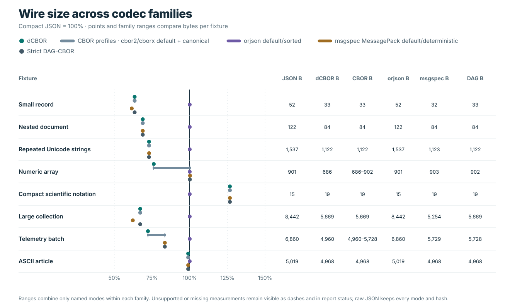

# CBOR competitor wire-size comparison

This benchmark measures serialized payload bytes for the six shared
JSON-compatible fixtures using compact UTF-8 JSON, dCBOR 0.1.0, `cbor2` 6.1.5
default and `canonical=True` modes, and `cborx` 0.2.5 default and
`canonical=True` modes. It does not measure Python object memory, PostgreSQL
storage, indexes, or query cost. Generic CBOR modes are useful codec
comparators; they do not thereby implement the dCBOR profile.

The main [encoded-size report](../encoded_size/README.md) retains the compact
JSON versus dCBOR chart and calls out the scientific-notation fixture where
JSON is smaller. This report adds generic CBOR codec results. The
[machine-readable output](results.json) records each implementation's version,
backend, payload hash, and absolute byte count. The stable
[wire-size graph](../../.github/assets/graphs/wire-size.svg) presents one panel
per fixture, with six codec rows, exact byte counts, and the percentage
difference from compact JSON. Every panel starts at zero and has its own scale;
use the printed values for comparisons across panels. Lower means fewer payload
bytes.



## Reproduce

From the repository root, install the pinned Python comparators, build the
optimized dcbor extension, and run the benchmark:

```sh
python -m pip install -r benchmarks/requirements.txt
CARGO_BUILD_JOBS=2 maturin develop --release --locked
PYTHONPATH=python python benchmarks/wire_size.py
```

The runner refuses to report a complete comparison unless `dcbor==0.1.0`,
`cbor2==6.1.5`, and `cborx==0.2.5` are available and the imported dcbor
extension matches `target/release/lib_dcbor.so` byte for byte. It checks
type-sensitive round trips for every encoder before recording sizes. If a
dependency, version, release artifact, or fixture check fails, the report and
graph show `blocked` or `failed` status rather than inventing or silently
omitting values.

The report records the source commit and cleanliness flag, benchmark script and
graph SHA-256 values, interpreter and platform, CPU, Rust/Cargo versions, root
`Cargo.lock` hash, dcbor release-artifact and extension hashes, comparator
module paths and native-extension status, fixture hashes, and hashes of all
encoded outputs. The cleanliness flag excludes all three generated benchmark
JSON reports and stable SVG charts, while retaining unrelated source and
worktree changes. The comparison uses byte-returning `dumps()` APIs; it does
not include database work or post-encoding transport.

## Interpretation and limits

The compared series are intentionally distinct:

| Series | Mode |
| --- | --- |
| Compact JSON | UTF-8, `ensure_ascii=False`, compact separators, non-finite numbers rejected. |
| dCBOR | Package profile encoding from the matching release extension. |
| `cbor2` default | Generic CBOR `dumps()` defaults. |
| `cbor2` canonical | `canonical=True`; cbor2 documents length-first map-key order (RFC 8949 §4.2.3). |
| `cborx` default | Generic CBOR `dumps()` defaults; backend status is recorded. |
| `cborx` canonical | `canonical=True`; project documentation specifies bytewise encoded-key order. |

The fixtures cover records, nesting, repeated Unicode text, common numeric
values, compact scientific-notation floats, and a larger collection. The
scientific-notation example is an unfavorable size case for binary CBOR: JSON
can write some large or small finite floats in fewer bytes than float64 CBOR.
The benchmark includes it alongside the other fixtures. In the recorded run,
compact JSON used 15 bytes for this fixture and all five CBOR modes used 19
bytes (+26.67%); this difference is called out in the graph. On the numeric
array,
`cbor2`/`cborx` default modes used 902 bytes (0.1% larger than JSON's 901),
while dCBOR and both generic canonical modes used 686 bytes. The full
fixture-by-fixture byte counts and hashes are in the raw report and graph.

These are payload-size measurements for the listed Python values and codecs.
The generic libraries have different accepted values, defaults, and
canonicalization rules. Their `canonical=True` options follow their own
library rules: cbor2 uses length-first map-key ordering, while cborx documents
bytewise encoded-key ordering. dCBOR applies its own profile rules, so these
modes are not interchangeable and neither generic canonical mode establishes
dCBOR conformance. JSON cannot represent all CBOR
values, including byte strings, arbitrary key types, semantic tags, NaN, and
infinity. PostgreSQL `jsonb` is a database storage/query feature and requires a
separate workload that accounts for server version, schema, indexes, and
transactions. No conclusion about universal size, speed, memory, or format
suitability follows from this fixture set.

The release-artifact check currently scopes the runner to Linux: it verifies
the imported extension against `target/release/lib_dcbor.so` by SHA-256.
