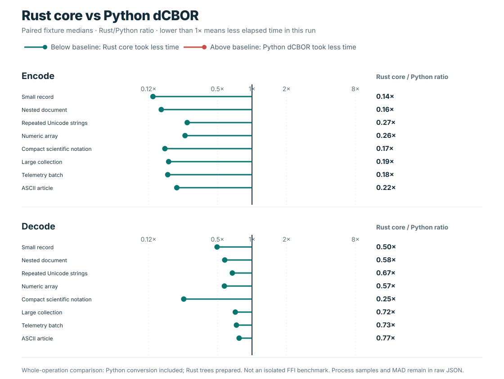

# Benchmark comparisons

The shared codec reports use eight JSON-compatible fixtures: a small record,
nested data, repeated Unicode, a numeric array, scientific-notation floats, a
large collection, a telemetry batch, and an ASCII article. They measure
serialized payload bytes and operation time on one recorded host (the current
capture uses CPython 3.14 on Linux). They do not measure memory, database
storage, transport, or application behavior. Each raw report includes
per-fixture values and run metadata.

## Encoded size

The [compact JSON and dCBOR report](../benchmarks/encoded_size/README.md)
shows exact UTF-8 JSON and dCBOR sizes. JSON may use fewer bytes for some
finite floats written in scientific notation; the figure keeps this workload
visible alongside the other fixtures.

## Wire size across codecs

The [wire-size report](../benchmarks/wire_size/README.md) adds `cbor2`,
`cborx`, `orjson`, `msgspec` MessagePack, and strict DAG-CBOR (`cbrrr`) to the
JSON and dCBOR series. It records the default and deterministic/sorted modes
separately. The plot uses compact JSON as the 100% reference, displays dCBOR
and DAG-CBOR as points, and groups each library's measured modes into a range.
Exact byte counts remain in the
[raw JSON](../benchmarks/wire_size/results.json).

These formats and modes have different rules. Generic CBOR canonical modes
are library-specific, not dCBOR. DAG-CBOR restricts map keys to strings,
requires binary64 floats, and allows only the CID tag. `orjson` and MessagePack
are different formats; `orjson` sorted-key JSON and MessagePack deterministic
ordering are not dCBOR profiles. The common fixtures contain finite
JSON-compatible values and do not test the broader accepted-value domains.

## Latency

The [latency report](../benchmarks/latency/README.md) times encode, decode,
and round-trip operations against Python's standard-library `json`. Each mode
is normalized to the JSON median for the same fixture and operation. In the
chart, whiskers show the min–max range across the eight fixture ratios; they
are not uncertainty intervals. The raw report retains per-fixture medians,
median absolute deviations (MAD), and fresh-process samples for every mode.

Timing summaries come from nine fresh processes on one host. They are useful
for inspecting this fixture set, not for predicting another workload or
establishing a universal ranking.

## dCBOR profile workloads

The [profile report](../benchmarks/profile/README.md) measures dCBOR on maps
with 10 to 10,000 keys in sorted, reversed, and seeded-shuffled insertion
orders; float normalization cases; and ASCII, NFC, decomposed, and expanding
Unicode text. It reports encode/decode medians and MAD, wire sizes, hashes,
and normalization metadata. These profile-specific cases are separate from
the common cross-codec fixtures and use the dCBOR normalization rules in their
correctness checks.

## Rust core and Python binding

The [Rust-core report](../benchmarks/rust_core/README.md) compares the patched
Rust core with Python binding calls on the same eight prepared wires. Rust
encoding starts from a tree constructed before timing, while `dcbor.dumps()`
includes Python-value conversion. The resulting whole-operation comparison
does not isolate FFI overhead. Decode uses prepared wire bytes for both sides;
the raw report includes medians, MAD, samples, and parity checks.

## Reports and reproduction

- [Encoded size](../benchmarks/encoded_size/README.md)
- [Wire size](../benchmarks/wire_size/README.md)
- [Latency](../benchmarks/latency/README.md)
- [dCBOR profile](../benchmarks/profile/README.md)
- [Rust core](../benchmarks/rust_core/README.md)
- [Benchmark index and commands](../benchmarks/README.md)
- [Codec and format landscape](competitive-landscape.md)
