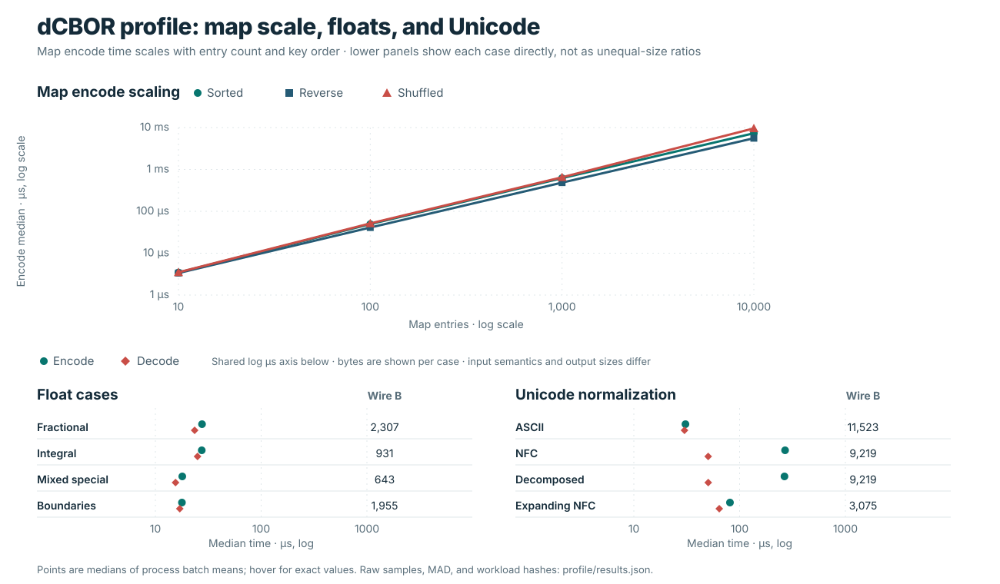

# Benchmark comparisons

The shared codec reports use eight JSON-compatible fixtures: a small record,
nested data, repeated Unicode, a numeric array, scientific-notation floats, a
large collection, a telemetry batch, and an ASCII article. They measure
serialized payload bytes and operation time on one recorded host (the current
capture uses CPython 3.14 on Linux). They do not measure memory, database
storage, transport, or application behavior. Each raw report includes
per-fixture values and run metadata.

The active reports and figures use dCBOR 0.1.1 at source commit `df70782`.

## Encoded size

The [compact JSON and dCBOR report](../benchmarks/encoded_size/README.md)
shows exact UTF-8 JSON and dCBOR sizes. JSON may use fewer bytes for some
finite floats written in scientific notation; the figure keeps this workload
visible alongside the other fixtures.

## Wire size across codecs

The [wire-size report](../benchmarks/wire_size/README.md) adds `cbor2`,
`cborx`, `orjson`, `msgspec` MessagePack, and strict DAG-CBOR (`cbrrr`) to the
JSON and dCBOR series. It records the default and deterministic/sorted modes
separately. The plot uses compact JSON as the 100% reference, displays dCBOR
and DAG-CBOR as points. Its generic-CBOR range combines the named `cbor2` and
`cborx` default/canonical modes; `orjson` and `msgspec` each have their own
mode range. Exact byte counts remain in the
[raw JSON](../benchmarks/wire_size/results.json).

These formats and modes have different rules. Generic CBOR canonical modes
are library-specific, not dCBOR. DAG-CBOR restricts map keys to strings,
requires binary64 floats, and allows only the CID tag. `orjson` and MessagePack
are different formats; `orjson` sorted-key JSON and MessagePack deterministic
ordering are not dCBOR profiles. The common fixtures contain finite
JSON-compatible values and do not test the broader accepted-value domains.

## Latency

The [latency report](../benchmarks/latency/README.md) times encode, decode,
and round-trip operations against Python's standard-library `json`. Each mode
is normalized to the JSON median for the same fixture and operation. In the
chart, whiskers show the min–max range across the eight fixture ratios; they
are not uncertainty intervals. The raw report retains per-fixture medians,
median absolute deviations (MAD), and fresh-process samples for every mode.

Timing summaries come from nine fresh processes on one host. They are useful
for inspecting this fixture set, not for predicting another workload or
establishing a universal ranking.

## dCBOR profile workloads

The [profile report](../benchmarks/profile/README.md) measures dCBOR on maps
with 10 to 10,000 keys in sorted, reversed, and seeded-shuffled source
insertion orders; float normalization cases; and ASCII, NFC, decomposed, and
expanding Unicode text. Its side-by-side map encode/decode panels share
logarithmic entry-count and time limits. The three map orders produce
identical canonical wire, so decode differences are measurement variation,
not evidence of insertion-order-dependent decoding. Four extra controls
(`integer_width_boundaries`, `dict_nfc_key_collisions`, `nested_scalar_tree`,
and `cbor_map_snapshot`) remain in the raw report but are not charted. These
profile-specific cases are separate from the common cross-codec fixtures and
use dCBOR normalization rules in their correctness checks.

## Direct Python encoding (`0.1.1` development)

The [paired direct-encoder report](../benchmarks/feat004/README.md) compares
matched release artifacts and identical wire output. Across the eight common
fixtures, the median encode ratio is 3.04× (range 1.16×–4.47×); round-trip is
1.59× and common-fixture decode is 1.02×, near parity. These ratios summarize
this fixture set, not a promised target. This separate FEAT004 paired capture
is distinct from the active reports above, which use dCBOR 0.1.1 at source
commit `df70782`. The original mixed-profile observation is preserved in the
[BUG_005 history](reviews/mixed_profile_decode_history.md).

## Native decoder paired profile

The [native decoder report](../benchmarks/native_decoder/README.md) compares
the preserved pre-migration package with the native decoder across 24 dCBOR
workloads. Input and wire fingerprints match, and decode medians improved for
all cases; the 10,000-entry maps improved by 5.29–5.41×. This supersedes the
older BUG_005 investigation for the current decoder without explaining the
former slowdown. The profile also found a slower integer-width encode control,
which is tracked separately as
[BUG_007](requirements/BUG_007_integer_encode_regression.md).

## Reports and reproduction

- [Encoded size](../benchmarks/encoded_size/README.md)
- [Wire size](../benchmarks/wire_size/README.md)
- [Latency](../benchmarks/latency/README.md)
- [dCBOR profile](../benchmarks/profile/README.md)
- [Native decoder paired profile](../benchmarks/native_decoder/README.md)
- [Benchmark index and commands](../benchmarks/README.md)
- [Codec and format landscape](competitive-landscape.md)
